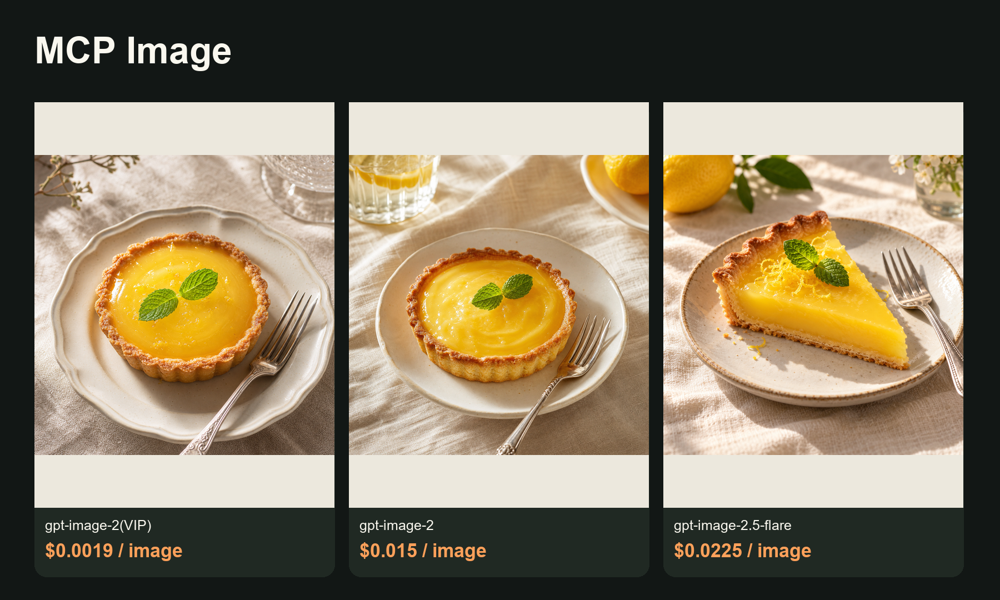

<!-- toapis-community-guide -->
# Lower-cost image API guide · ToAPIs community fork


<!-- TOAPIS-MODELS-20261020 -->
## Model support and prices · 2026-10-20

Added standalone API presets: 31 image request templates and 8 video presets. Current-key pricing matches 26 image and 8 video presets; 5 image templates block new paid calls while pricing is unavailable. Native provider/UI/import/render acceptance remains as documented in the original guide below.

| Image model / tested preset | Current preset quote / image | Historical example amount / image | Fee evidence |
|---|---:|---:|---|
| gpt-image-2(VIP)<br><sub>low</sub> | $0.0019/image | **$0.0019/image** | Billing log, phase unknown |
| gpt-image-2.5-flare-vip<br><sub>low</sub> | Current-key quote unavailable | **$0.005272/image**<br><sub>Token-metered; current $/M unavailable. This sample is not a fixed image tariff.</sub> | Task receipt settled |
| nano_banana<br><sub>1K</sub> | $0.012/image | **$0.012/image** | Billing log, phase unknown |
| gemini-nano-banana-2.1<br><sub>1K</sub> | $0.015/image | **$0.015/image** | Billing log, phase unknown |
| gpt-image-2<br><sub>1K</sub> | $0.015/image | **$0.015/image** | Billing log, phase unknown |
| gemini-nano-banana-2.1-vip<br><sub>1K</sub> | $0.02/image | **$0.02/image** | Billing log, phase unknown |
| qwen-image-3.0<br><sub>1K</sub> | Current-key quote unavailable | **$0.021/image** | Billing log, phase unknown |
| gpt-image-2.5-flare<br><sub>high</sub> | $0.0225/image | **$0.0225/image** | Billing log, phase unknown |
| gpt-image-2.5-sunburst<br><sub>high</sub> | $0.0225/image | **$0.0225/image** | Billing log, phase unknown |
| flux-2-pro<br><sub>1K</sub> | $0.025/image | **$0.025/image** | Billing log, phase unknown |
| doubao-seedream-5-0-pro<br><sub>1K</sub> | $0.042857/image | **$0.042856/image** | Billing log, phase unknown |

| Video model | Preset / input | Settled clip charge | File duration | Case USD/s, ascending |
|---|---|---:|---:|---|
| MiniMax-H3-Max-Turbo | 5s / 480P / text-to-video | $0.125/clip | 5.18s | **$0.024131/s**<br><sub>Pricing tariff: $0.025/s</sub> |
| seedance-2-mini | 4s / 480p / first-frame | $0.13338/clip | 4.04s | **$0.033015/s**<br><sub>Pricing tariff: $3.285714/M total tokens</sub> |
| seedance-2-fast | 4s / 480p / text-to-video | $0.214568/clip | 4.04s | **$0.053111/s**<br><sub>Pricing tariff: $5.285714/M total tokens</sub> |
| kling-v3 | 5s / 720p / std / text-to-video | $0.3/clip | 5.04s | **$0.059524/s**<br><sub>Pricing tariff: $0.06/s</sub> |
| MiniMax-H3 | 5s / 768p / text-to-video | $0.32/clip | 5.17s | **$0.061896/s**<br><sub>Pricing tariff: $0.064/s</sub> |
| seedance-2 | 4s / 480p / first-frame | $0.26676/clip | 4.04s | **$0.06603/s**<br><sub>Pricing tariff: $6.571429/M total tokens</sub> |
| kling-3.0-turbo | 4s / 720p / text-to-video | $0.32/clip | 4.04s | **$0.079208/s**<br><sub>Pricing tariff: $0.08/s</sub> |
| seedance-2-5 | 4s / 480p / text-to-video | $0.3883/clip | 4.04s | **$0.096114/s**<br><sub>Pricing tariff: $10/M total tokens</sub> |

Pricing checked 2026-10-20. Image examples are dated 2026-10-17; video examples 2026-10-20. Tables sort by example amount or case USD/s. Presets and input modes differ; this is not a matched-settings quality ranking. Unknown-phase image logs are not confirmed final net settlements. Current quotes and historical amounts are separate. Video charges are billing=settled; case USD/s divides charge by actual file duration, never processing time. Token tariffs appear in small text and do not imply a fixed per-second price.

gpt-image-2(VIP) starts at $0.0019/image; this low/1K preset is $0.0019/image. The standalone sampler has 31 historically successful image request templates and 8 video presets. Current-key pricing matches 26 image and 8 video presets; 5 image templates block new paid submission until an exact price is available.

[Local sampler](toapis-models/README.md) · [Full price table](PRICING.md) · [Original media and fee evidence](https://github.com/ToAPIs-2025/toapis-quickstart/tree/main/tutorials/model-support-2026-10-20)

Original project examples, historical charges and integration instructions follow. Historical amounts are not rewritten as today’s quotes.

<!-- /TOAPIS-MODELS-20261020 -->

This fork adds an independently maintained optional image client, original examples and a dated price guide. The upstream MCP provider registry/defaults below are preserved; full MCP tool registration and end-to-end app acceptance are pending.

[English guide](toapis-guide/README.md) · [中文教程](toapis-guide/README_zh-CN.md) · [Case prices, ascending](toapis-guide/PRICING.md) · [Matching model](https://go2v.toapis.com/1019_mcp_g)



| Tested image model | Rate |
|---|---:|
| gpt-image-2(VIP), low / 1K | $0.0019/image |
| gpt-image-2, 1K | $0.015/image |
| gpt-image-2.5-flare, high / 1K | $0.0225/image |

2026-10-19 configured rates; original outputs are real, individual image task settlement was unavailable. Run the standalone recipe from `toapis-guide/`. This is a guide contribution, not an upstream-endorsed edition of the app.
<!-- /toapis-community-guide -->

# MCP Image Generator 🍌

> Generate and edit images from Codex, Cursor, Claude Code, or any MCP client. mcp-image adds visual direction to your request before sending it to Gemini, OpenAI, or BytePlus Seedream.

[](https://www.npmjs.com/package/mcp-image)
[](https://www.npmjs.com/package/mcp-image)
[](https://opensource.org/licenses/MIT)

Tell it what image to create or what to change in an existing image, and what it is for. The result is saved to disk and returned to your assistant.

## What It Does

Before generating an image, mcp-image rewrites short requests into more specific prompts. It keeps what you asked for and fills in details such as composition, lighting, and camera angle. The more detail you provide, the less it changes.

**You ask:**

> "A photo of a roast chicken dinner for a recipe site. It should look like it was actually cooked, and it should be partway through being carved so you can tell how juicy it is."

**mcp-image sends to the image model:**

> "... a freshly roasted whole chicken resting on a rustic, seasoned wooden carving board. The chicken features **deeply bronzed, blistered, and crispy skin** ... It is **partway carved, with one breast cleanly sliced open** to reveal **tender, steaming-hot white meat glistening with natural juices pooling** slightly onto the board ... **shallow depth of field** with a softly blurred background."


*Generated with Gemini using the default `fast` quality preset.*

What carried through:

- `for a recipe site`: one clear subject, with everything else kept subordinate
- `actually cooked`: blistered, uneven browning, rising steam, and drippings on the knife
- `partway through being carved`: one breast sliced open, with the cut piece still resting against the bird
- `how juicy it is`: juices pooling on the board and shallow depth of field around the cut

<details>
<summary>Compare the same request with prompt enhancement turned off</summary>


*Baseline from the same request, with prompt enhancement disabled.*

Set `SKIP_PROMPT_ENHANCEMENT=true` to send the original prompt to the image model unchanged.

</details>

## Quick Start

You need Node.js 22 or later, an MCP-compatible client, and an API key for one image provider.

### 1. Get an API key

All three providers generate and edit images. Gemini is the default and requires the least configuration.

| Provider | Image size | Output format | Setup |
|----------|------------|---------------|-------|
| Gemini (default) | 1K, 2K, 4K | Automatic | [Get a key](https://aistudio.google.com/apikey), then set `GEMINI_API_KEY` |
| OpenAI | 1K, 2K, 4K | PNG or JPEG | [Get a key](https://platform.openai.com/api-keys), then set `IMAGE_PROVIDER=openai` and `OPENAI_API_KEY` |
| BytePlus Seedream | 1K, 2K | PNG or JPEG | [Get an AP region key](https://console.byteplus.com/ark/region:ark+ap-southeast-1/apikey), then set `IMAGE_PROVIDER=seedream` and `ARK_API_KEY` |

Google Search grounding is available with Gemini only. OpenAI may require organization verification before it can generate images.

The examples below use Gemini. Replace the provider settings if you prefer OpenAI or Seedream.

### 2. Configure your MCP client

#### Codex

Add this to `~/.codex/config.toml`:

```toml
[mcp_servers.mcp-image]
command = "npx"
args = ["-y", "mcp-image"]

[mcp_servers.mcp-image.env]
GEMINI_API_KEY = "your_gemini_api_key_here"
IMAGE_OUTPUT_DIR = "/absolute/path/to/images"
```

#### Cursor

Add this to `~/.cursor/mcp.json` for all projects, or `.cursor/mcp.json` in a project:

```json
{
  "mcpServers": {
    "mcp-image": {
      "command": "npx",
      "args": ["-y", "mcp-image"],
      "env": {
        "GEMINI_API_KEY": "your_gemini_api_key_here",
        "IMAGE_OUTPUT_DIR": "/absolute/path/to/images"
      }
    }
  }
}
```

#### Claude Code

Run this in your project directory:

```bash
claude mcp add mcp-image --env GEMINI_API_KEY=your-api-key --env IMAGE_OUTPUT_DIR=/absolute/path/to/images -- npx -y mcp-image
```

Add `--scope user` after `mcp-image` to make it available in every project.

Never commit API keys to version control. Use an absolute `IMAGE_OUTPUT_DIR` in MCP configuration because the server's working directory depends on the client. If omitted, images are written to `./output` relative to that working directory.

### 3. Generate an image

Restart your MCP client after changing its configuration, then ask your AI assistant:

```text
Generate a product photo of a ceramic coffee mug on a wooden desk.
```

The generated file is saved in the configured output directory and returned to the assistant as an MCP resource.

<details>
<summary>Run mcp-image from a local checkout</summary>

```bash
pnpm install
pnpm run build
```

Configure the MCP client to run the local build instead of `npx -y mcp-image`:

```bash
node /absolute/path/to/mcp-image/dist/index.js
```

</details>

## More Examples

### Edit an existing image

Give the assistant an absolute path to the source image:

```text
Edit /path/to/image.jpg so the person is facing right.
```

### Control the result

- `Generate a high-quality product photo of a smartphone with clear text on the screen.`
- `Generate a cinematic desert landscape in a 21:9 aspect ratio.`
- `Keep the knight's appearance consistent with the previous image.`

See the [tool reference](#tool-reference) for the options your assistant can pass explicitly.

## Configuration

Changing the provider changes both prompt enhancement and image generation. The way you ask for an image stays the same.

### Quality

`IMAGE_QUALITY` accepts `fast` (default), `balanced`, or `quality`. Set it in the MCP server environment:

```bash
IMAGE_QUALITY=balanced
```

Use `fast` to try ideas quickly, `balanced` for everyday use, and `quality` for complex scenes or images where small details matter. Higher settings can take longer and cost more; results vary by provider.

All three providers support these presets for generation and editing. You can override the default with the `quality` option on each request.

### Environment variables

| Variable | Default | Description |
|----------|---------|-------------|
| `IMAGE_PROVIDER` | `gemini` | Default provider: `gemini`, `openai`, or `seedream` |
| `GEMINI_API_KEY` | - | API key for Gemini |
| `OPENAI_API_KEY` | - | API key for OpenAI |
| `ARK_API_KEY` | - | ModelArk AP API key for Seedream |
| `IMAGE_OUTPUT_DIR` | `./output` | Directory where generated images are saved; use an absolute path in MCP configuration |
| `IMAGE_QUALITY` | `fast` | Default quality preset: `fast`, `balanced`, or `quality` |
| `SKIP_PROMPT_ENHANCEMENT` | `false` | Set to `true` to send prompts through unchanged |

You can configure keys for more than one provider and switch per request. A request-level `provider` option takes precedence over `IMAGE_PROVIDER`.

## Tool Reference

Your MCP client calls this tool for you. Open the reference when you need to check an option or provider limitation.

<details>
<summary><code>generate_image</code> parameters</summary>

| Parameter | Type | Required | Description |
|-----------|------|----------|-------------|
| `prompt` | string | Yes | Image description or editing instruction |
| `quality` | string | No | `fast`, `balanced`, or `quality`; overrides `IMAGE_QUALITY` |
| `provider` | string | No | `gemini`, `openai`, or `seedream`; overrides `IMAGE_PROVIDER` |
| `inputImagePaths` | string[] | No | Absolute paths to input images for editing |
| `fileName` | string | No | Output filename; `.png`, `.jpg`, or `.jpeg` selects the format for OpenAI and Seedream |
| `aspectRatio` | string | No | `1:1` (default), `2:3`, `3:2`, `3:4`, `4:3`, `4:5`, `5:4`, `9:16`, `16:9`, `21:9`, `1:4`, `1:8`, `4:1`, or `8:1` |
| `imageSize` | string | No | `1K`, `2K`, or `4K`; availability depends on the provider |
| `blendImages` | boolean | No | Add blending guidance when combining visual elements |
| `maintainCharacterConsistency` | boolean | No | Keep a character's appearance consistent across images |
| `useWorldKnowledge` | boolean | No | Add context for historical figures, landmarks, and factual scenes |
| `useGoogleSearch` | boolean | No | Gemini only. Use Google Search grounding for current information |
| `purpose` | string | No | Intended use, such as `cookbook cover` or `social media post` |

</details>

## Troubleshooting

### API key not found

Check that the key for the selected provider is present in the MCP server's environment:

- Gemini: `GEMINI_API_KEY`
- OpenAI: `OPENAI_API_KEY`
- Seedream: `ARK_API_KEY`

Restart the MCP client after changing its configuration.

### Input image file not found

Use absolute paths and make sure the MCP server can read the files. Input images can be PNG, JPEG, or WebP and must be no larger than 10 MiB each. Seedream editing accepts PNG and JPEG only.

### Provider rejects a request

Check the requested size in the provider table. `useGoogleSearch` works with Gemini only, and Seedream does not support 4K. For OpenAI permission errors, check your [organization settings](https://platform.openai.com/settings/organization/general). For quota or rate-limit errors, check the selected provider account.

## Image Generation Prompt Skill

This repository also includes an [Agent Skill](https://agentskills.io) for assistants that already have access to an image generation tool. It teaches the prompt-writing approach used by mcp-image and works independently of this server.

Install it with:

```bash
npx mcp-image skills install --path <skills-directory>
```

For example, use `~/.codex/skills`, `~/.cursor/skills`, or `~/.claude/skills` as the destination.

## License

MIT License. See [LICENSE](LICENSE) for details.

---

Need help? [Open an issue](https://github.com/shinpr/mcp-image/issues) or check [Troubleshooting](#troubleshooting).
